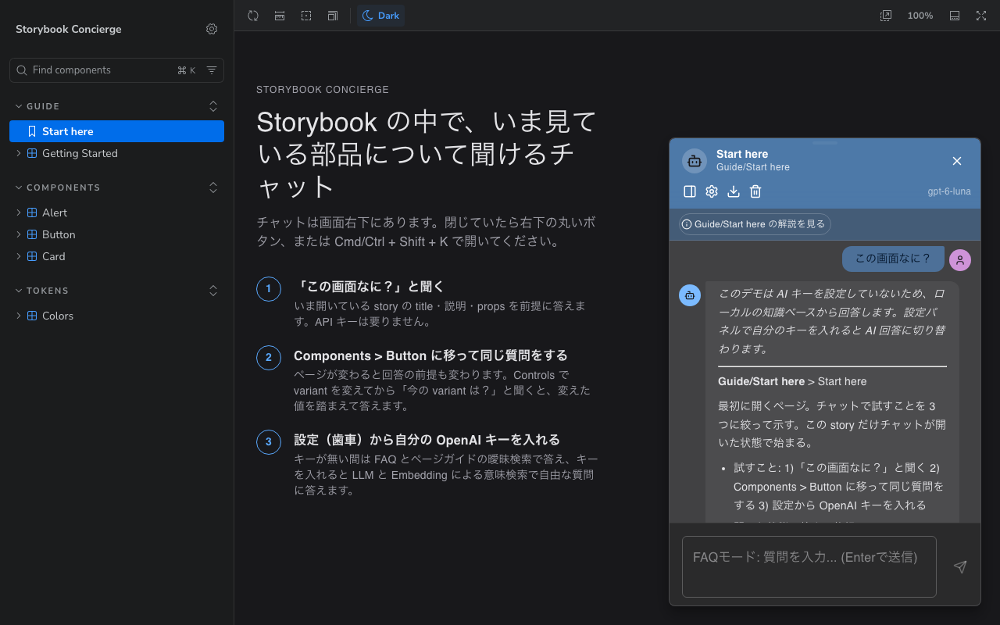
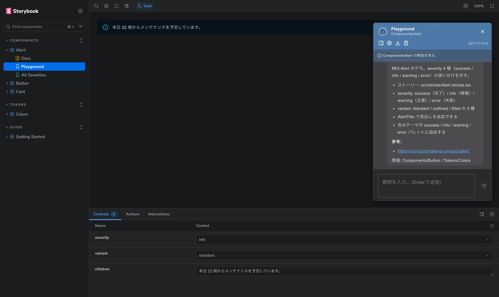
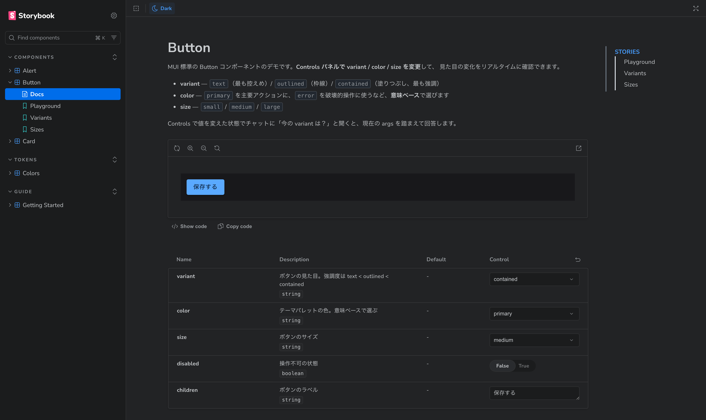
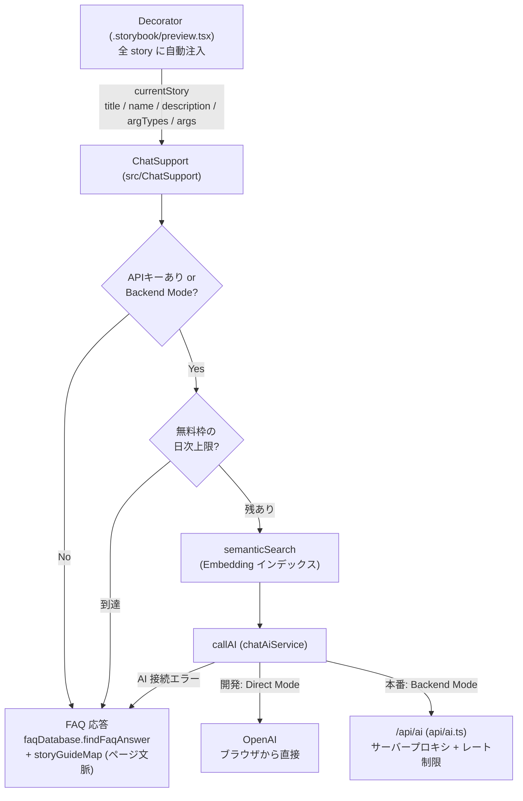

# storybook-concierge

Storybook の全 story に常駐し、**いま画面に出ている部品について質問に答える AI チャット**。デザインシステムを使う実装者が、ドキュメントを探しに行かずにその場で聞けるようにするためのリファレンス実装です。

**デモ: https://storybook-concierge.vercel.app/?path=/story/guide-start-here--start-here** （API キー不要。開くと右下でチャットが開いています）

[](./LICENSE)



> **TL;DR (English):** An AI chat widget that lives on every Storybook story and answers questions about the component on screen, using the story's title / description / argTypes / args as context. Without an API key it answers from a built-in FAQ (fuzzy search) and a per-page guide; with an OpenAI key it uses the LLM plus embedding-based semantic search. Shared builds never contain credentials (backend proxy + rate limit). MIT licensed.

## 見どころ

- **story の文脈をそのまま渡す**: Decorator が全 story に注入し、title / description / argTypes / args を実行時に渡す。知識ベースを書かなくても、そのページについて答える — [.storybook/preview.tsx](./.storybook/preview.tsx)
- **キーなしでも動く 2 段構え**: キーなしでは FAQ とページガイドの曖昧検索で回答、キーありで OpenAI と Embedding による意味検索。AI 呼び出しが失敗しても FAQ に戻る — [src/ChatSupport/hooks/useChatMessage.ts](./src/ChatSupport/hooks/useChatMessage.ts)
- **公開ビルドにキーを焼き込まない**: 本番ビルドでは資格情報の define を機械的に空にし、`/api/ai` のプロキシと IP ごとの日次上限で守る — [.storybook/main.cjs](./.storybook/main.cjs) / [api/ai.ts](./api/ai.ts) / [lib/ratelimit.ts](./lib/ratelimit.ts)

## 試し方（デモ）

1. デモを開く（右下のチャットが開いた状態で始まります。閉じていたら右下の丸いボタンか Cmd/Ctrl + Shift + K）
2. 「この画面なに？」と送る。いま開いている story を前提に答えます
3. サイドバーの Components > Button に移り、Controls で variant を変えてから「今の variant は？」と聞く

デモはサーバー側に AI キーを置いていないため、ローカルの知識ベースで答えます。チャットの設定（歯車）に自分の OpenAI キーを入れると AI 回答に切り替わります。

ページ文脈の回答（Button）:



## デモの動かし方

```bash
pnpm install
pnpm storybook   # http://localhost:6206
```

これだけで動きます。**API キーは不要**です。キーが無い場合、Concierge は FAQ とページガイドの曖昧検索で応答します（「この画面は何？」のようなページ文脈の質問にも答えます）。

Docs ページ（dark が既定。ツールバーの Theme で light に切り替えられます）:



## テーマ

**dark が既定**。ツールバーの Theme から light に切り替えられる。

UI カタログは実装者が長時間見るものなので、まず暗い面で成立することを
確認したい、という判断。dark を後付けにすると「塗り面に白文字を固定する」
ような、明るい面でだけ成立する書き方が入り込む。

dark 化には **3 つの層**があり、どれか 1 つ欠けると中途半端になる。

| 層                         | 設定場所                                       | 欠けたときの症状                  |
| -------------------------- | ---------------------------------------------- | --------------------------------- |
| chrome（サイドバー・検索） | `.storybook/manager.ts`                        | Canvas は暗いのにサイドバーが白い |
| Docs ページ                | `parameters.docs.theme`                        | Docs タブだけ白い                 |
| Canvas の中身              | `preview.tsx` の ThemeProvider + `CssBaseline` | 暗い地に明るい部品が乗る          |

両テーマのコントラストは実測で検証している。

```bash
pnpm check:contrast   # dark + light、チャットパネルの中まで測る
```

## 他プロジェクトへの導入

`src/ChatSupport/` は**自己完結している**（ディレクトリ外への import が無い）。
コピーして Decorator を配線すれば、**知識ベースを 1 行も書かなくても
そのプロジェクトのページについて答える**。

Storybook が既に持っているメタ情報（story の title / name /
`parameters.docs.description.component` / 現在の args）を Decorator が実行時に渡すため。

```
storyGuideMap 登録ゼロの状態で「この画面なに？」と聞いた実際の応答:

  Controls パネルで variant / color / size を変更して、見た目の変化を…
  - variant — text（最も控えめ）/ outlined（枠線）/ contained（塗りつぶし）
  …
  このページで触れる props: variant, color, size, disabled, children
```

より深い回答が要るページは、Storybook から下書きを生成して足す。

```bash
pnpm build-storybook
pnpm generate:story-guide > src/ChatSupport/storyGuideMap.generated.ts
```

FAQ は `CHAT_FAQ`（チャット操作・Storybook 一般。そのまま使える）と
`PROJECT_FAQ`（このデモ固有。差し替える）に分かれている。

手順の全体と検証ゲートは `skills/add-storybook-concierge/SKILL.md` にある。
Claude Code なら、このスキルを `~/.claude/skills/` か対象プロジェクトの
`.claude/skills/` に置けばそのまま実行できる。

## API キーを使う場合

自由質問に AI で答えさせたい場合は、`.env.example` を `.env` にコピーしてキーを設定します。

```bash
cp .env.example .env
# VITE_OPENAI_API_KEY=... を設定
pnpm storybook
```

各項目の説明は [.env.example](./.env.example) を参照してください。

### 共有キーを配らない設計

このリポジトリは「チームに共有キーを配って各自の `.env` に貼る」運用を意図的に避けています。

| モード               | キーの置き場所                                               | 用途             |
| -------------------- | ------------------------------------------------------------ | ---------------- |
| Direct Mode（開発）  | `.env` の `VITE_OPENAI_API_KEY`（ブラウザから直接呼ぶ）      | ローカル開発のみ |
| Backend Mode（本番） | サーバー環境変数（`OPENAI_API_KEY` 等、`VITE_` prefix なし） | 公開デプロイ     |

- `build-storybook`（本番ビルド）では、`.storybook/main.cjs` が **資格情報の define をビルド種別で機械的に空文字にする**ため、`.env` にキーが残っていても共有ビルドには焼き込まれません
- 本番は同一オリジンの `/api/ai`（[api/ai.ts](./api/ai.ts)、Vercel Function）を経由します。キーはサーバー側にだけ存在し、`lib/ratelimit.ts` が IP ごとの日次上限を適用します
- 利用者が自前キーを持つ場合は `X-User-API-Key` ヘッダーで送り、レート制限を免除できます
- Origin 許可リストは硬い天井にはならないため、**請求の上限はプロバイダ側の予算設定**で設けてください

## アーキテクチャ



- Decorator は `viewMode !== 'docs'` のときだけ注入します（Docs ページは 1 ページに複数 story が並び、文脈が一意でないため。FAB の重複防止も兼ねる）
- `parameters.disableDecoratorChat: true` で story 単位のオプトアウトができます（ChatSupport 自身のデモ story で使用）
- AI 呼び出しに失敗した場合も FAQ にフォールバックし、「送っても何も起きない」状態を作りません

## ディレクトリ構成

```
storybook-concierge/
├── .storybook/
│   ├── main.cjs             # Storybook 設定（esnext / destructuring 対策、本番でのキー除去）
│   ├── manager.ts           # chrome のテーマ・ブランド名、入口 story のレイアウト
│   ├── manager-head.html    # OGP / meta description
│   └── preview.tsx          # Decorator（全 story への Concierge 注入）、story の並び順
├── src/
│   ├── ChatSupport/         # Concierge 本体（FAB + チャット UI + AI/FAQ ロジック）
│   │   └── maxOutputTokens.ts  # モデル別 maxOutputTokens の単一ソース（ブラウザ/サーバー共用）
│   ├── stories/             # デモ用 story（Guide/Start here が入口）
│   └── theme/               # MUI テーマ / モーショントークン
├── lib/
│   ├── cors.ts              # Origin 許可リスト
│   └── ratelimit.ts         # 日次レート制限（Upstash Redis / in-memory）
├── api/
│   └── ai.ts                # バックエンドプロキシ（Vercel Function）
├── public/
│   └── og-image.png         # OGP 画像（1200x630、Start here の実画面）
├── scripts/
│   └── finalize-static-html.mjs  # ビルド後に index.html を lang="ja" と固定タイトルへ
├── skills/
│   └── add-storybook-concierge/
│       └── SKILL.md         # 既存 Storybook への組み込み手順（Claude Code 用）
└── .env.example             # 環境変数の説明
```

## 既存の Storybook に組み込む

Claude Code が実行できる再現手順を [skills/add-storybook-concierge/SKILL.md](./skills/add-storybook-concierge/SKILL.md) に置いています。手で組み込む場合も、同ファイルの手順と検証ゲートをそのまま使えます。

## License

MIT © 2026 [BoxPistols](https://github.com/BoxPistols)
